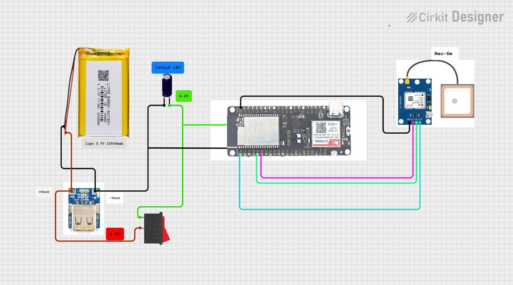

# ESP32 + SIM800L GPS Telemetry

A real-time vehicle tracker with hybrid connectivity (WiFi first, GPRS via SIM800L as fallback) and a Neo-6M GPS module. It publishes position over TLS to HiveMQ Cloud, and a browser dashboard plots it live on a map.

## Repository layout

```
firmware/     PlatformIO project for the tracker (ESP32 + SIM800L + Neo-6M)
  src/main.cpp
  include/secrets.example.h   copy to secrets.h and fill in (secrets.h is gitignored)
  platformio.ini
dashboard/    Single-file web dashboard (Leaflet map + MQTT over WebSockets)
  index.html
docs/         Wiring diagram
```

## Hardware

* **Board**: TTGO T-Call (AM-036, ESP32 + SIM800L)
* **GNSS**: Neo-6M GPS module
* **Power**: TP4056 Li-Ion charging module, 10000mAh battery, and a 1000µF capacitor to absorb SIM800L transmit bursts

### Pinout

| Peripheral | ESP32 pin | Function |
| :--- | :--- | :--- |
| SIM800L RX | `IO27` | UART AT command interface TX |
| SIM800L TX | `IO26` | UART AT command interface RX |
| SIM800L RST | `IO5` | Hardware reset |
| SIM800L PWKEY | `IO4` | Power-on toggle |
| SIM800L POWER_ON | `IO23` | Modem power rail enable |
| Neo-6M RX | `IO2` | GNSS UART TX |
| Neo-6M TX | `IO25` | GNSS UART RX |
| Capacitor | JST pin | Stabilizes the power supply |



Place the 1000µF capacitor physically close to the SIM800L power input to prevent brownouts when the modem transmits.

## Quick start

### 1. Clone

```bash
git clone https://github.com/musannatarique/ESP32-Sim800l-GPS-Telemetry.git
cd ESP32-Sim800l-GPS-Telemetry
```

Update later with `git pull`.

### 2. Firmware

**Windows one-click:** run `flash.bat` from the repo root. First run creates `firmware\include\secrets.h` and opens it; fill it in, run `flash.bat` again to build, flash and open the serial monitor. Use `flash.bat COM5` to force a port.

**CI:** every push builds the firmware on GitHub Actions (with placeholder secrets, to check it compiles). The `firmware-esp32dev` artifact is on the run page. The binary has placeholder credentials, so for a real device build locally with your own `secrets.h`.

Manual steps:

Requires [PlatformIO](https://platformio.org/).

```bash
cd firmware
cp include/secrets.example.h include/secrets.h   # then edit secrets.h
pio run                                          # build
pio run --target upload                          # flash over USB
pio device monitor                               # serial log
```

`secrets.h` holds the device ID, carrier APN, and HiveMQ credentials. It is listed in `.gitignore`, so it never gets committed.

On first boot with no saved WiFi, the tracker opens a setup access point named `TRACKER-SETUP-AP` for 2 minutes. If nobody configures it, it carries on over GPRS.

### 3. Dashboard

Open `dashboard/index.html` in a browser. While the placeholders in its `config` block are unchanged, it runs in **demo mode** with a simulated moving marker, so you can check the map works. Fill in your HiveMQ host, username, password and device topic to go live.

## MQTT contract

| Topic | Direction | Payload |
| :--- | :--- | :--- |
| `gps/devices/<id>/location` | tracker publishes every 5 s | JSON, see below |
| `gps/devices/<id>/status` | retained, with Last Will | `{"online":true}` or `{"online":false}` |

Location payload:

```json
{"fix":true,"lat":23.810300,"lon":90.412500,"speed_kmph":12.4,"sats":8,"hdop":1.1,"net":"WiFi","uptime_s":340}
```

When there is no valid recent fix, `lat` and `lon` are omitted, so the dashboard keeps the last known position instead of jumping to `0,0`.

## Security notes

* Everything in `dashboard/index.html` is visible to anyone who can load the page. Create a **separate HiveMQ credential for the dashboard that can only subscribe**, and a **publish-only credential for the tracker**.
* Without a root CA in `secrets.h`, the WiFi link is encrypted but the broker is not authenticated. Paste the ISRG Root X1 certificate into `MQTT_ROOT_CA` to verify it.
* HiveMQ Cloud requires TLS 1.2, and the SIM800 has limited TLS support. WiFi works reliably. If MQTT will not connect over GPRS, use a newer modem (SIM7600, A7670) or a broker that accepts plain MQTT on a private APN.
